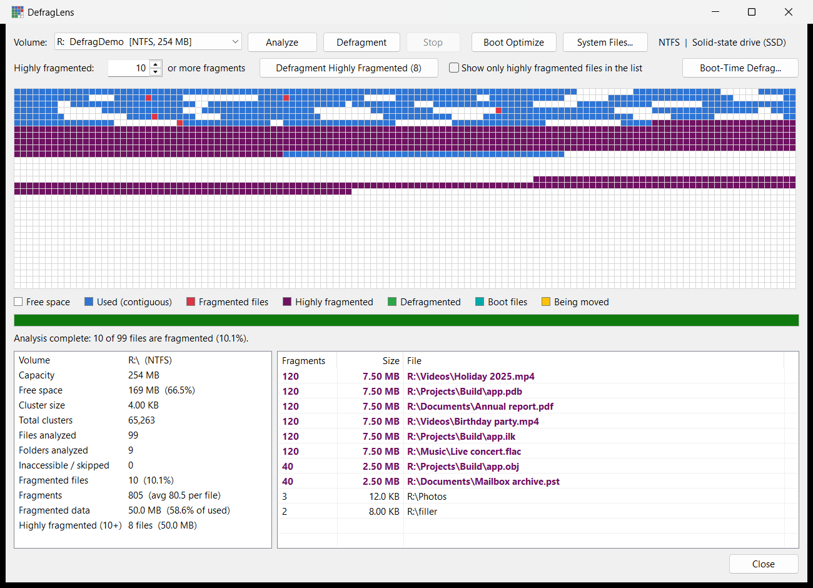

# DefragLens

A Windows desktop disk defragmenter written in C++ with MFC. It analyzes a volume, shows how
fragmented it is on a live cluster map, and defragments files with the defragmentation API
built into Windows. It uses the same file-system API as Windows' own optimizer, without calling `defrag.exe`.

**Platforms:** Windows 10 / 11, x64 and Win32 (32-bit). **Language:** C++17. **Framework:** MFC, linked statically.

## Screenshots



## Features

- **Volume picker**: lists fixed and removable drives with label, file system and size; the Windows drive is preselected.
- **Media detection**: shows whether the volume is on an SSD or a hard disk, and warns before defragmenting an SSD.
- **Analyze**: walks every file and folder on the volume and counts how many fragments each one has.
- **Defragment**: moves each fragmented file into a single contiguous free run, smallest files first.
- **Highly fragmented files**: set a threshold (default 10 fragments). Files at or above it are shown in purple on the map and in bold purple in the file list, and are counted in the statistics. **Defragment Highly Fragmented** moves only those files, which is much quicker than a full pass.
- **Boot Optimize**: reads the list of files Windows loads at startup (`%SystemRoot%\Prefetch\Layout.ini`), defragments them, and packs them together in boot order as close to the start of the volume as possible.
- **System Files report**: read-only fragmentation report for `pagefile.sys`, `hiberfil.sys`, `swapfile.sys` and `$MFT`, read straight from the NTFS file records while Windows keeps them locked. Fixes are offered behind a confirmation:
  - set a fixed page file size, with the previous setting saved so you can restore it
  - recreate the hibernation file
  - consolidate the MFT
- **Boot-Time Defrag** (optional): schedules a one-time pass at the next restart, before Windows starts services or opens the page file. It retries files that were in use, and also handles the page, swap and hibernation files and the MFT. It has a dry-run mode, a time limit and a log.
- **Live cluster map**: color-coded grid of the whole volume, updated while work is in progress.
- **Statistics**: capacity, free space, cluster size, files and folders analyzed, fragmented files, fragments per file and fragmented data.
- **Most fragmented files**: up to 2,000 files sorted by fragment count; double-click one to show it in Explorer.
- **Right-click to defragment**: right-click one file, or select several (Ctrl/Shift+click), for **Defragment**, **Open File Location** and **Copy Path**. Shift+F10 or the Menu key opens the same menu.
- **Stop at any time**: cancels between move chunks; closing the window while busy asks first.
- Resizable window, high-DPI aware, single self-contained `.exe` (MFC linked statically).

### Cluster map legend

| Color | Meaning |
|---|---|
| White | Free space |
| Blue | Used, not fragmented |
| Red | Belongs to a fragmented file |
| Purple | Belongs to a highly fragmented file (at or above the threshold) |
| Green | Defragmented in this run |
| Teal | Boot files listed in `Layout.ini` |
| Amber | File currently being moved |

Each cell covers a range of clusters. A cell is drawn as used if any cluster in its range is in use.

## Requirements

| | |
|---|---|
| OS | Windows 10 or 11: the x64 build for 64-bit Windows, the Win32 build for 32-bit Windows |
| Rights | Administrator (the app asks for elevation when it starts) |
| File systems | NTFS, FAT, FAT32, exFAT (ReFS and network drives are not supported) |
| To build | Visual Studio 2022 or newer, with the **Desktop development with C++** workload and the **C++ MFC for latest build tools (x86 & x64)** component |

## Building

### Visual Studio

1. Open `DefragLens.sln`.
2. Select the **Release** configuration and the **x64** or **Win32** platform.
3. Build the solution. It produces `bin\<platform>\Release\DefragLens.exe` and the boot-time program `bin\<platform>\Release\DefragLensBoot.exe`. Keep the two together: Boot-Time Defrag installs the second from next to the first.

### Command line

From a *Developer PowerShell for VS*:

```bash
msbuild DefragLens.sln /p:Configuration=Release /p:Platform=x64 /m
```

```bash
msbuild DefragLens.sln /p:Configuration=Release /p:Platform=Win32 /m
```

All four configurations (Debug and Release, x64 and Win32) build with no warnings at warning level 4.

### Continuous integration

`.github/workflows/build.yml` builds the solution on GitHub Actions for every push to `main`, every pull request and every `v*` tag. You can also start it by hand from the **Actions** tab.

1. It runs on a `windows-2022` runner, which has Visual Studio 2022 with the C++ MFC component.
2. It builds **Release** for **Win32** and **x64** with warnings treated as errors (`/p:TreatWarningAsError=true -warnaserror`). Any compiler, linker, resource or MSBuild warning fails the build.
3. It packages both platforms into one zip and uploads it as the run's single artifact. The upload uses `archive: false`, so the download is the zip itself:

```
DefragLens-<version>.zip
├── README.md
├── Win32/
│   ├── DefragLens.exe
│   └── DefragLensBoot.exe
└── x64/
    ├── DefragLens.exe
    └── DefragLensBoot.exe
```

`<version>` is the tag name for tag builds (for example `v1.0.0`), `v1.0.<run number>` for pushes to `main`, and the short commit hash otherwise.

4. For a push to `main` or a `v*` tag, a release job then publishes the zip as a GitHub release. For a push to `main` it creates the tag `v1.0.<run number>` on the built commit. The Deployments installer takes `x64\DefragLens.exe` and `x64\DefragLensBoot.exe` from this zip. To change the major or minor version of the automatic releases, edit `v1.0.` in the workflow's *Package* step.

The project uses the `v143` toolset. Newer Visual Studio versions may offer to retarget it; either choice works.

## Usage

1. Run `DefragLens.exe` and accept the administrator prompt.
2. Choose a volume from the **Volume** list.
3. Click **Analyze**. When it finishes, the map shows fragmented files in red, and the statistics panel and file list fill in.
4. Click **Defragment** to process every fragmented file. If you skipped Analyze, the program analyzes the volume first.
   - To handle only the worst files, set **Highly fragmented: _N_ or more fragments** and click **Defragment Highly Fragmented (_count_)**.
   - Changing the threshold immediately updates the map, the statistics, the list highlighting and the button's count.
   - Tick **Show only highly fragmented files in the list** to hide the rest.
   - To defragment particular files, select them in the list, right-click and choose **Defragment**. This works on the files already listed, even if the analysis was stopped part-way.
5. Click **Stop** to cancel. The volume stays consistent: Windows performs each move atomically, so a stopped run leaves files either moved or unmoved, never damaged.

### Boot Optimize

1. Select the Windows volume and click **Boot Optimize**. Analyzing first is optional, but it also shows the boot files on the map in teal.
2. The program reads `C:\Windows\Prefetch\Layout.ini`, keeps the listed files that are on this volume and can be moved, and works out their total size.
3. It looks for the first free area, from the start of the volume, that can hold all of them. It then moves the files into it one after another, in the order Windows reads them at startup.
4. If no single free area is big enough, it defragments each boot file separately instead. The status line says which of the two it did.

Running it again when the files are already packed in order does nothing.

`Layout.ini` exists only when the **SysMain** service is running. Windows maintains it for hard disks, not SSDs. Without it, Boot Optimize explains what's missing and changes nothing.

### System Files

Click **System Files...** (NTFS volumes only) to see:

| File | What the report shows | Fix offered |
|---|---|---|
| `pagefile.sys` | Size, fragments | **Set Fixed Page File Size**: writes `PagingFiles` as `C:\pagefile.sys N N` (current size), which turns off automatic management. Takes effect after a restart. **Restore Page File Setting** puts the saved original back. |
| `hiberfil.sys` | Size, fragments, or "hibernation off" | **Recreate Hibernation File**: runs `powercfg /hibernate off` then `on`, so Windows allocates it again. |
| `swapfile.sys` | Size, fragments | None. Windows manages it together with the page file. |
| `$MFT` | Size, fragments | **Consolidate MFT**: moves every extent except the first (which NTFS pins) into one free run. Use with a recent backup. |

Every fix asks for confirmation and says exactly what it will change. A fixed page file size stops new fragmentation but doesn't rearrange the existing pieces. The dialog explains how to rebuild the page file in one piece.

The saved page file setting is stored at `HKCU\Software\DefragLens\DefragLens\Settings\PagingFilesBackup`.

### Boot-Time Defrag

Some files can't be moved while Windows is running, because Windows keeps them open. Examples are `pagefile.sys`, `swapfile.sys`, `hiberfil.sys` and files held open by services. **Boot-Time Defrag...** schedules a one-time pass for the next restart. It runs from the `BootExecute` registry value, the stage where Windows' own disk check (`autochk`) runs. At that point the page file isn't open yet and no services are running.

**Choose what to process:**
- Files that couldn't be moved while Windows was running. Defragment and Boot Optimize remember these, and the status line points to Boot-Time Defrag when there are any.
- The page file, swap file and hibernation file.
- The MFT, except its first piece.

**Safety measures**

| Risk | How it is handled |
|---|---|
| A problem repeats on every boot | The program removes its `BootExecute` entry and deletes its job file **before** doing anything else, so it runs only once. When the main program next starts, it also removes any entry left without a job. |
| The volume is already damaged | Scheduling is refused if the volume is marked as needing repair. At boot, the program checks again and moves nothing if the volume is marked. Windows' disk check always runs before it. |
| Power loss or crash during a move | Moves use only `FSCTL_MOVE_FILE`, the same journaled NTFS operation as normal defragmentation. NTFS copies the clusters and switches the file over atomically, so each file stays whole in its old or new place. Nothing is ever written to the disk directly. |
| Startup takes too long | A time limit (1–240 minutes, default 10) stops the pass between moves. |
| Unknown behavior on your PC | **Dry run**, on by default, checks everything and writes a log but moves nothing. Run it once first, read the log, then schedule a real pass. |
| No visibility | Progress shows on the boot screen. Every step is written to `%SystemRoot%\DefragLensBoot\boot.log`, flushed line by line. The next time the program starts, it shows the summary, and **View Last Log** opens the full log. |

> **Use Restart, not Shut down.** With Fast Startup on, *Shut down* followed by power-on resumes a saved session and skips the `BootExecute` stage. The scheduled pass then waits until the next real restart.

Files involved:
- `%SystemRoot%\System32\DefragLensBoot.exe`: the boot-time program, copied there when you schedule.
- `%SystemRoot%\DefragLensBoot\job.txt`: what to do. The program deletes it as it starts.
- `%SystemRoot%\DefragLensBoot\boot.log`: what it did.
- The `DefragLensBoot` entry in `HKLM\SYSTEM\CurrentControlSet\Control\Session Manager\BootExecute`.

**Cancel Scheduled Run** removes the registry entry and the job file. To remove everything by hand, delete the `DefragLensBoot` line from `BootExecute`, then delete the files above.

> **Tip:** Try it on a spare drive or USB stick before your Windows drive. Analyzing a large system drive can take several minutes.

## Settings

The highly fragmented threshold is saved as soon as you change it and restored the next time the program starts:

| Key | Value | Type | Default |
|---|---|---|---|
| `HKEY_CURRENT_USER\Software\DefragLens\DefragLens\Settings` | `HighFragmentThreshold` | `REG_DWORD` | `10` |

If the stored value is outside 2–100,000, it is clamped into that range. To reset to the default, delete the key:

```bash
reg delete "HKCU\Software\DefragLens" /f
```

The program runs elevated, so the setting goes to the hive of the account that approved the UAC prompt.
When you elevate with a different administrator account, that account's `HKEY_CURRENT_USER` is used, not yours.

## How it works

The engine talks to the volume directly through these Windows I/O control codes:

| Control code | Purpose |
|---|---|
| `FSCTL_GET_VOLUME_BITMAP` | Reads the volume's allocation bitmap: one bit per cluster, set when in use. Used for the map and the free-space search. |
| `FSCTL_GET_RETRIEVAL_POINTERS` | Returns a file's extents (where each run of its clusters lives on disk). Physically non-adjacent runs are counted as fragments. |
| `FSCTL_MOVE_FILE` | Asks the file system to relocate a range of a file's clusters to a given location. This is the same mechanism Windows' own defragmenter uses. |
| `FSCTL_GET_NTFS_FILE_RECORD` | Reads a file's MFT record so the System Files report can decode where locked files live without opening them. |
| `IOCTL_STORAGE_QUERY_PROPERTY` | Queries the seek penalty, which tells SSDs from hard disks. |

**Analysis** reads the bitmap, then walks the directory tree with long-path (`\\?\`) names and
requests each entry's extents. It doesn't follow junctions and symbolic links, so it can't loop.

**Defragmentation** takes the fragmented files (or, for **Defragment Highly Fragmented**, only those
with at least the threshold number of fragments, or, from the right-click menu, only the selected
files) and sorts them by size, then for each file:

1. Re-reads its extents, skipping it if it has already become contiguous.
2. Finds a free run large enough using a next-fit search of the bitmap.
3. Moves the file's extents there in chunks of up to 16,384 clusters, checking for Stop between chunks.
4. Re-reads the extents to confirm the file is now contiguous.

The bitmap is re-read every 64 files and after any failed move, and a failed file is retried once.

The SE_MANAGE_VOLUME, SE_BACKUP and SE_RESTORE privileges are enabled when a volume is opened, so that
more files can be opened for analysis.

## Project structure

```
DefragLens/
├── DefragLens.sln                  Solution
├── README.md
├── .gitignore
├── .gitattributes                  Line-ending rules (Windows line endings for Visual Studio files)
├── .github/
│   └── workflows/build.yml         CI: builds Win32 + x64 Release and uploads one zip artifact
└── src/
    ├── DefragLens.vcxproj          Project (Debug/Release, x64/Win32, static MFC, requires admin)
    ├── DefragLens.vcxproj.filters  Solution Explorer folders
    ├── DefragLens.cpp / .h         Application class: initializes common controls and shows the dialog
    ├── DefragLensDlg.cpp / .h      Main window: layout, buttons, statistics, file list, worker thread
    ├── DefragEngine.cpp / .h       Volume analysis and defragmentation (runs on the worker thread)
    ├── ClusterMapCtrl.cpp / .h     Double-buffered, DPI-aware cluster map with legend
    ├── SystemFiles.cpp / .h        Reads system file extents from NTFS file records; page file / hibernation fixes
    ├── SystemFilesDlg.cpp / .h     System Files report dialog
    ├── BootTimeJob.cpp / .h        Schedules/cancels the boot-time pass (BootExecute, job file, log)
    ├── BootTimeDlg.cpp / .h        Boot-Time Defrag dialog
    ├── BootTime/
    │   ├── DefragLensBoot.vcxproj  Native-subsystem program: links only ntdll.dll, no C runtime
    │   ├── BootMain.cpp            Runs at boot: unregister, read job, check volume, move, log
    │   └── NtApi.h                 Native API declarations not in the Windows SDK headers
    ├── DefragLens.rc / resource.h  Dialog template, icon and version info
    ├── pch.cpp / pch.h             Precompiled header
    ├── targetver.h                 Windows SDK version
    └── res/DefragLens.ico          Application icon
```

Build output goes to `bin\<platform>\<configuration>\` and `obj\<platform>\<configuration>\` next to the solution, not inside `src\`.
The CI workflow is in `.github/workflows/build.yml`.

The 32-bit boot-time program needs the compiler's 64-bit arithmetic helpers (`__alldiv`, `__aullshr` and so on). `ntdll.lib` doesn't export them, so the Win32 build links those self-contained objects from the static C runtime. It still imports nothing but `ntdll.dll`.

### Threading model

`CDefragEngine::Analyze()`, `Defragment()`, `DefragmentFiles()` and `BootOptimize()` run on a worker thread started with `AfxBeginThread`.
The System Files dialog's **Consolidate MFT** runs `ConsolidateMft()` directly on the UI thread, with a wait cursor.
The engine guards its shared state with a mutex and exposes thread-safe snapshots
(`BuildCellMap`, `GetStats`, `GetStatusText`, `GetFragmentedFiles`) for the UI.
Progress is reported with `PostMessage`. Updates are throttled to about seven per second:

- `WM_DEFRAG_PROGRESS`: `wParam` = percent complete
- `WM_DEFRAG_DONE`: `wParam` = operation, `lParam` = success

## Limitations

- **Compressed and sparse files are skipped.** Moving them requires alignment to compression units.
- **No free-space consolidation.** A file that needs a larger contiguous run than any free gap is reported as *could not be moved*.
- **Some system files cannot be moved while Windows is running**, such as `pagefile.sys`, `swapfile.sys` and `hiberfil.sys`, because Windows keeps them open. **Boot-Time Defrag** can try them at the next restart, before Windows opens them. Most NTFS metadata files cannot be moved at all; the MFT can be consolidated except for its first piece.
- **Cloud placeholders and offline files are skipped**, so OneDrive-style files are never downloaded.
- **Use the build that matches Windows.** The Win32 build also runs on 64-bit Windows for analysis and defragmentation, but not for **Boot-Time Defrag**. Nothing 32-bit can run that early in a 64-bit Windows startup, so it asks you to use the x64 build instead.
- **SSDs:** defragmenting gains little and adds write wear, and Windows already optimizes SSDs with TRIM.

## Troubleshooting

| Symptom | Cause / fix |
|---|---|
| "Cannot open volume ... Run the program as administrator." | The app wasn't elevated. Accept the UAC prompt, or right-click → *Run as administrator*. |
| "... uses ReFS, which does not support defragmentation." | Only NTFS and FAT-family volumes are supported. |
| Many *Inaccessible / skipped* entries | System-protected files and folders that can't be opened even with backup privileges. This is expected. |
| Build error about missing `afxwin.h` | Install the *C++ MFC for latest build tools* component in the Visual Studio Installer. |
